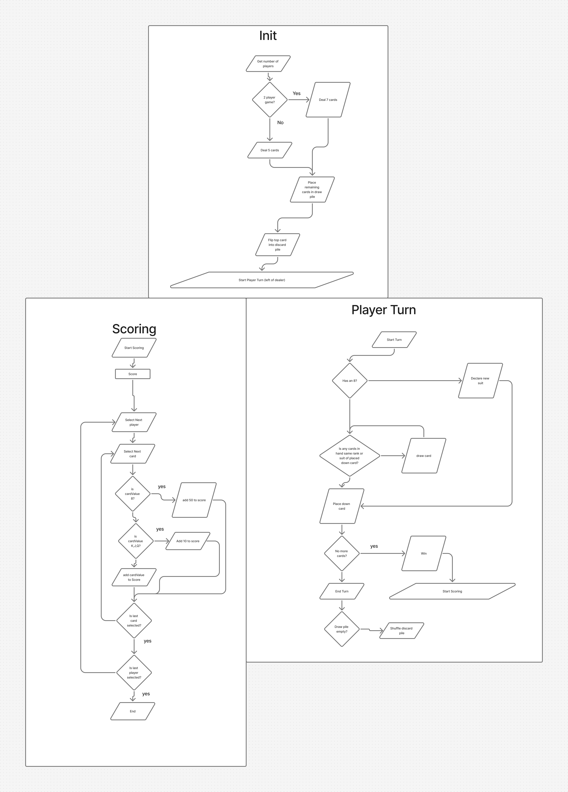

# 01 Interactive Application & Crazy Eights

## Crazy Eights

Crazy eights was the first program I was going to tackle, as my experience and skill in C++ exceeds my knowledge in python, after working through some of the examples given in workshops I had sketched up the flowchart for the 3 main sections of the program, Initialisation, Player Turns and Scoring

my idea was the same as the rules of crazy eights given to us but with the balancing change of issuing 7 cards in a 2 player game compared to 5 all the time to put it closer to the more commonly played version

While we were given acsess to a number of basic template files, i chose to create my project from scratch to give me better flexibility and suit better to my workflow. This included using JetBrains CLion and CMake instead of Visual Studio and MSBuild as my main development was on a Mac and I wanted to make sure that cross-platform building was easily possible.

To start off i created the C++ source and header files for each system i would need to implement, I also created a git repository to track my changes incase regressions were introduced.

After creating this i started to implement the Card deck, as its the simplest thing to write. My deck class contains a constructor which allows you to specify whether it is a discard pile or a draw pile, if discard pile is selected it will not generate the cards or allow you to draw from it.

Deck generation is achieved by a nested for loop generating 13 card for 4 suits and placing them into an private vector to make sure that the class has full control over the deck. I then implemented helper functions to draw cards, add cards (if discard pile)

The deck vector contains its own class of cards, this class is header-only as i found having it as a traditional cpp+h structure harder to read for such a simple class. its values are set at creation and you can only get values from it.

Using a guide on how to use operators i added a feature allowing the c++ standard library to use its own comparison functions for cleaner code in other sections

Suits are handled with a custom enum library (https://github.com/aantron/better-enums) which allows me to directly cast enums to strings, integers and also do direct comparisons with them easily.

###### generated with padoc + weasyprint