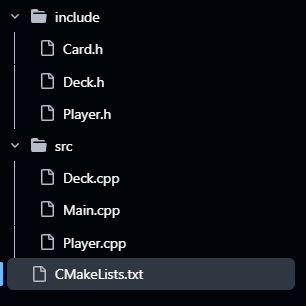
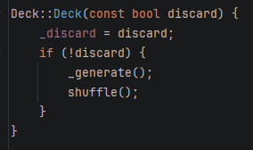
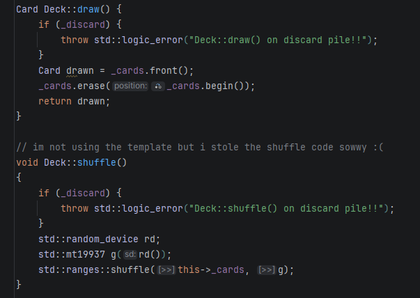
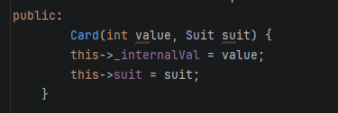
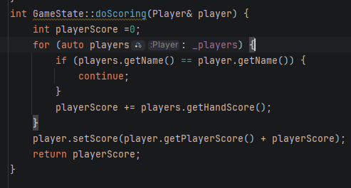
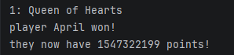
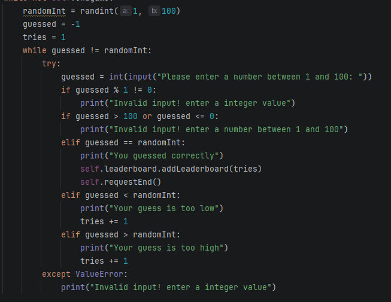
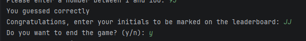
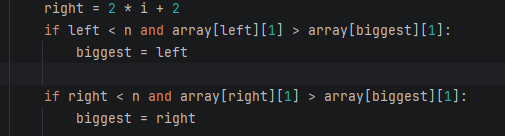
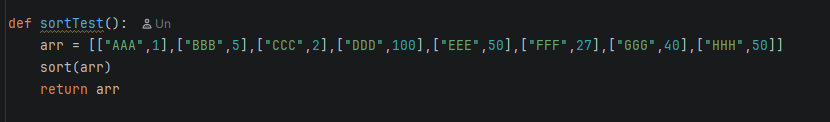

# 01 Interactive Application & Crazy Eights

## Crazy Eights

Crazy eights was the first program I was going to tackle, as my experience and skill in C++ exceeds my knowledge in python, after working through some of the examples given in workshops I had sketched up the flowchart for the 3 main sections of the program, Initialisation, Player Turns and Scoring.

My idea was the same as the rules of crazy eights given to us but with the balancing change of issuing 7 cards in a 2 player game compared to 5 all the time to put it closer to the more commonly played version.

While we were given access to a number of basic template files, I chose to create my project from scratch to give me better flexibility and suit better to my workflow. This included using JetBrains CLion and CMake instead of Visual Studio and MSBuild as my main development was on a Mac and I wanted to make sure that cross-platform building was easily possible.

To start off, I created the C++ source and header files for each system I would need to implement, I also created a git repository to track my changes incase regressions were introduced.

After creating this I started to implement the Card deck, as it's the simplest thing to write. My deck class contains a constructor which allows you to specify whether it is a discard pile or a draw pile, if discard pile is selected it will not generate the cards or allow you to draw from it.

Deck generation is achieved by a nested for loop generating 13 card for 4 suits and placing them into a private vector to make sure that the class has full control over the deck. I then implemented helper functions to draw cards, add cards (if discard pile)

The deck vector contains its own class of cards, this class is header-only as I found having it as a traditional cpp+h structure harder to read for such a simple class. its values are set at creation, and you can only get values from it.

Using a guide on how to use operators I added a feature allowing the c++ standard library to use its own comparison functions for cleaner code in other sections

Suits are handled with a custom enum library (https://github.com/aantron/better-enums) which allows me to directly cast enums to strings, integers and also do direct comparisons with them easily.

I intentionally designed the program to be extensible with virtual member functions, this allows other code to override the behaviour of a function to change how it works, this is used here to give the program support for multiple frontends.

this can then be changed by other c++ files.

I started expanding this with an "interfaces" system allowing the user facing interface to be swapped out at build time with the build flags system available in CMake.

I only ended up creating a bot interface for automated testing and the required command line interface, i had plans for a tui system but i was not able to implement it due to time constraints.

I also created a main `GameState` class which is responsible for abstracting the game loop and communication with all other parts of the game away from the main interface, so all that has to be done is instantiating the `GameState` class and running the `mainLoop()` method. This takes in a vector of `Player` classes which gives the program full control on how players are created in the game.

Each player turn will 

* check the state of the deck
* check the state of the player's hand
* precalculate all possible moves for that turn
* call `chooseCard()` to ask the frontend for a card to use
* if it's a valid card add it to the top of the discard pile and end the players turn
* if it's an eight, call `declareNewSuit()` to get the frontend to choose a new suit to play

if the players hand is then empty, time to start scoring `doScoring()`

scoring is calculated with all the values of other players hands added up and then added to the winning player, this is done with a method in the player class called `getHandScore()` which is then summed for all players and added to the winning players hand with `setScore()`

A bug I discovered quite late in working on the project was that on macOS, my score would be returned correctly, however on Windows it would return wildly different values to what I expected, the cause of this was uninitialized memory.

For security reasons, macOS will zero out memory pages once they are freed, however on Windows, it will keep whatever was in there beforehand and hand a page over that still has data in it.

This was an easy fix by just setting the value of `_score` to 0 in the constructor so its always initialised.

To find edge cases late in development, i created a special bot interface that would simulate a number of the people playing the game very quickly, this testing helped discover multiple bugs in the program including the above-mentioned scoring bug and also issues with declaring suits.

In conclusion this project helped me refresh my memory in c++ and introduced me to some practices that I wasn't fully familiar with.

## The Number Guessing Engine

The second project we were tasked with creating was a number guessing game.

The program would roll a random number between 1-100 and the user would have to guess what the number is, only being given "too high" or "too low" responses.

While this project was the easiest, I ended up neglecting the project due to this and also my reduced knowledge in python from not using it for a few years.

I started off by implementing the bare amount to get the basic idea of the program functional, which was

* Generating a random number
* Checking player input
* Responding whether it was too high or too low
* ending the program if they got the right answer

I made sure to add robust input checking preventing floating point entries, numbers greater than 100 and less than 1. the try; except block will catch all non number input, when invalid input is entered it will repeat the question until the input is valid.

Every guess increments a "tries" variable that is used for the leaderboard.

After a correct guess, the program asks for initials so that it can write your score to the leaderboard, this contains checking to make sure that it doesn't exceed 3 characters, after this it gets written to a 2D array and the player is asked if they want to play again.

To meet the requirement the leaderboard must be sorted but using an algorithm implemented by hand instead of included in any library

The leaderboard class contains a function that calls my sorting algorithm in a seperate file. The algorithm I chose was heapsort. It works by creating a binary tree of the values, then moves the biggest element in that tree to the end. This is repeated until the list is sorted.

While slower than other algorithms such as quicksort, it is simpler to implement and has a better worst case performance of O(n log n).

I referenced two sites containing pseudocode in order to help me implement this algorithm

 https://fullyunderstood.com/pseudocodes/heap-sort/

 https://sites.cc.gatech.edu/classes/cs3158_98_fall/heapsort.html

After this, I modified the algorithm to make sure that it was aware of the fact that I was using a 2-dimensional array to implement both names and guesses 

I added a small test to the algorithm that I could independently verify that the algorithm was functional

###### generated with padoc + weasyprint